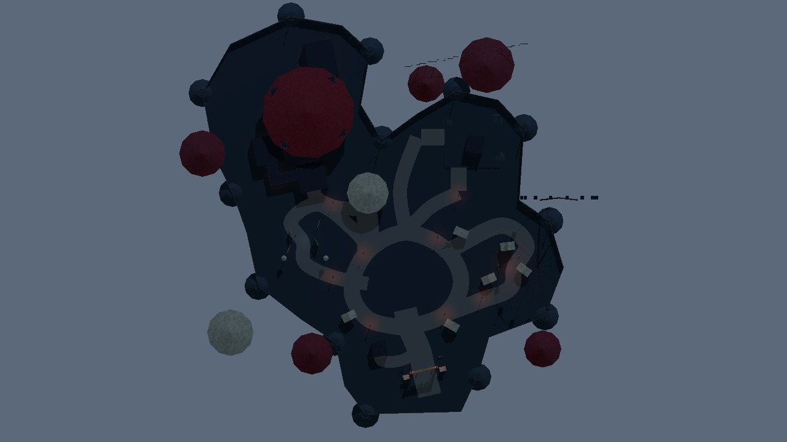

# Hub carnival layout

## Spatial plan

The active level uses an irregular fairground outline, an open central midway and three independently traversable branch loops. Paths curve between attractions rather than following parallel rows. The surrounding non-playable rides are separate geometry beyond the perimeter.

The entrance is to the south, with the ticket office offset to its west. The central hub is approximately 50 × 44 m; normal path ribbons are 6–9 m wide. Mirror grounds occupy a broad western loop. Prize stalls surround the eastern courtyard instead of filling the hub center. The service loop rises 0.8 m into a 24 × 22 m yard, using two approximately 10 m long, 7 m wide ramps.

The northwest stage has a broad audience approach and a tent canopy. The story quarter is rotated 0.2 radians and turns west through Broadcast Control, then north through an L-shaped backstage transition. Control and Owner's Office each have 12 × 12 m floors. Backstage is intentionally narrower at 4 m, with doors at least 3.2 m wide. The retained indoor theatre uses its existing 2.8 m side doorway. Its rear exit reaches a separate 12 × 16 m ending room.

The original entrance, ticket office, outdoor stage, power shed, indoor theatre, player and useful prop/material resources are instanced directly. Earlier complete map assemblies are retained as inactive references. The new blockout does not depend on, or stack over, the old rectangular floor.

The image above is an orthographic authoring capture. Fog was disabled and ambient light raised only in the capture process so paths are readable. Runtime sky, moon and fog settings were not changed. The screenshot is indicative; the static path baker is the authoritative ground definition.

## Navigation and authoring anchors

`HauntedCarnival` remains the map instance name in the main scene. Its new scene is `carnival_hub_layout.tscn`. World-space `*Waypoint` markers on this root define collision-test travel points.

| Area | Node path within HauntedCarnival |
| --- | --- |
| Entrance | Entrance |
| Ticket office / first TV | TicketBooth / ChannelZeroFoundation |
| Route A / Fuse 1 | MirrorRoute / Fuse1PickupMarker |
| Route B / Fuse 2 | PrizeRoute / Fuse2PickupMarker |
| Route C / Fuse 3 | PowerShed / ChannelZeroFoundation / Fuse3PickupMarker |
| Main stage / TV | MainStage / StageTelevisionMarker |
| Broadcast control | StoryQuarter / ControlRoom |
| Backstage | StoryQuarter / Backstage |
| Owner's Office | StoryQuarter / OwnersOffice |
| Final theatre | StoryQuarter / FinalTheatre |
| Canonical ending TV and choice | StoryQuarter / EndingRoom / EndingTelevisionMarker and EndingChoiceMarker |

The reused theatre still contains its earlier reveal-stage TV markers. New ending work should target the separate EndingRoom markers above. No markers activate story behavior. The earlier sealed gate asset remains preserved but is not part of this new endpoint.

## Exact source file manifest

Modified existing files:

- `scenes/main.tscn` — switches to the new assembly and moves the player spawn.
- `tests/carnival_validation.gd` — validates marker-based traversal of the active map, including its loops, elevation, walls and controls.
- `tests/channel_zero_validation.gd` — compatible entry point for the same active-map checks.
- `README.md` — current launch, route and test instructions.

Created map scenes:

- `scenes/maps/carnival_hub_layout.tscn` — active world assembly, sparse placement, service platform/ramps, perimeter, signs and navigation anchors.
- `scenes/maps/hub_ground.tscn` — baked irregular floor, curved paths, rounded banks and collision.
- `scenes/maps/funhouse_grounds.tscn` — spacious Route A mirror court and Fuse 1 position.
- `scenes/maps/prize_courtyard.tscn` — spaced Route B stalls and mannequin placeholders.
- `scenes/maps/broadcast_control_blockout.tscn` — larger control room and channel positions.
- `scenes/maps/backstage_elbow.tscn` — intentional L-shaped transition.
- `scenes/maps/owners_office_blockout.tscn` — larger office and recording/document anchors.
- `scenes/maps/ending_broadcast_room.tscn` — separate ending TV room and choice anchor.
- `scenes/maps/carnival_story_quarter.tscn` — angled story-quarter assembly and theatre tent silhouette.
- `scenes/maps/hub_distant_scenery.tscn` — non-playable wheel, carousel, tents and coaster silhouettes.

Created shared assets, tools and documentation:

- `scenes/props/open_stall_blockout.tscn` — lightweight pitched-canopy stall.
- `materials/blockout_path.tres`
- `materials/blockout_soil.tres`
- `materials/blockout_bank.tres`
- `tools/build_hub_ground.gd` — offline ground/path/bank baker.
- `tools/hub_layout_ground.json` — editable ground outline, path curves and bank definitions.
- `docs/hub_layout.md` — this document.
- `docs/hub_layout_overview.png` — authoring overview.

Godot may create the baker's `.gd.uid` and the overview's `.png.import` metadata during import. Cached test logs and capture scripts are confined to the ignored `.godot/` directory. No old map scenes, player files, sky shaders, existing materials or project input settings were edited or deleted.
